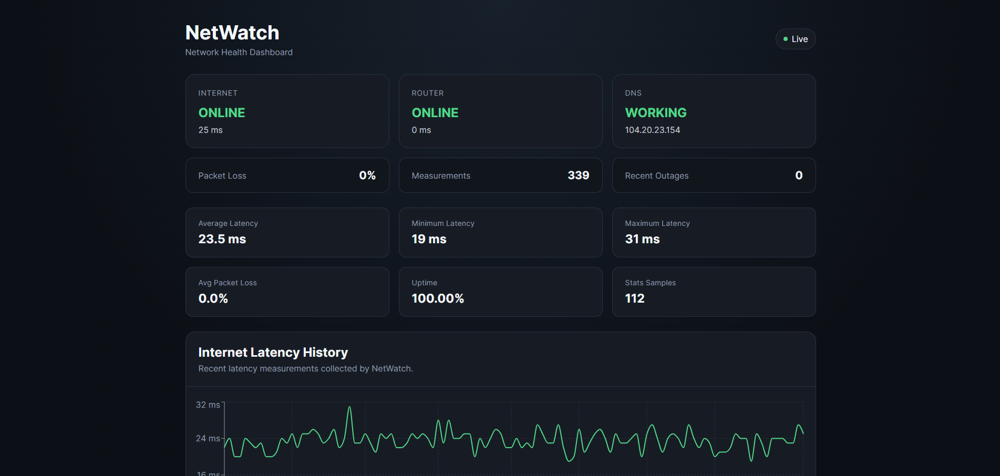
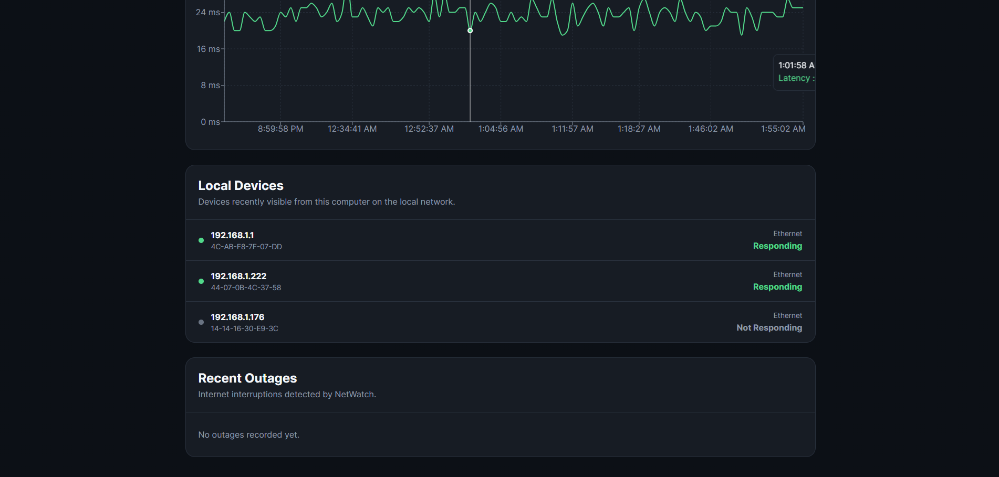

# NetWatch

NetWatch is a real-time home network monitoring dashboard built to track internet reliability, latency, packet loss, DNS health, outages, and devices visible on a local network.

The system runs continuously in the background on a Windows 11 computer, stores network measurements in a local SQLite database, exposes the data through a FastAPI backend, and displays everything through a React + TypeScript dashboard.

## Dashboard Preview

### Network Overview



### Device and Outage Monitoring



## Features

- Real-time internet connectivity monitoring
- Router availability monitoring
- DNS health checks
- Latency tracking
- Packet-loss tracking
- Automatic outage detection
- Outage duration tracking
- Historical network measurements
- Average latency statistics
- Minimum and maximum latency statistics
- Average packet-loss statistics
- Network uptime percentage
- Live latency graph
- Local network device discovery
- Device response monitoring
- Recent outage history
- Stale-monitor detection
- Automatic background startup on Windows
- Responsive web dashboard
- Local data storage
- REST API with interactive Swagger documentation

## How It Works

NetWatch continuously checks the health of the local network and internet connection.

The monitoring service performs several checks:

- Detects the Windows default gateway
- Pings the local router
- Pings an external internet target
- Measures latency
- Measures packet loss
- Tests DNS resolution
- Reads Windows' local network neighbor table
- Checks whether discovered devices respond to ping
- Detects when internet service goes offline
- Detects when service is restored
- Calculates outage duration

All measurements are stored locally in SQLite.

FastAPI exposes the stored data through REST endpoints, and the React frontend reads those endpoints to display the current network status, statistics, historical graphs, outages, and discovered devices.

## Architecture

```text
Windows Network
      |
      v
Python Monitoring Agent
      |
      +---- Router Check
      |
      +---- Internet Check
      |
      +---- DNS Check
      |
      +---- Local Device Discovery
      |
      v
SQLite Database
      |
      v
FastAPI Backend
      |
      +---- /status
      +---- /measurements
      +---- /history
      +---- /stats
      +---- /outages
      +---- /devices
      |
      v
React + TypeScript Dashboard
```

## Technologies

### Backend

- Python
- FastAPI
- Uvicorn
- SQLite
- Python `subprocess`
- Python `socket`
- Windows PowerShell networking commands

### Frontend

- React
- TypeScript
- Vite
- Recharts
- CSS

### Platform and Tools

- Windows 11
- PowerShell
- Windows Task Scheduler
- VS Code
- Git
- GitHub
- npm
- ESLint

## Project Structure

```text
NetWatch/
|
├── backend/
│   ├── __init__.py
│   ├── database.py
│   ├── main.py
│   ├── monitor.py
│   └── requirements.txt
│
├── frontend/
│   ├── public/
│   ├── src/
│   │   ├── App.tsx
│   │   ├── App.css
│   │   ├── index.css
│   │   └── main.tsx
│   ├── package.json
│   ├── package-lock.json
│   └── vite.config.ts
│
├── data/
│   └── .gitkeep
│
├── docs/
│   └── screenshots/
│       ├── dashboard-overview.png
│       └── dashboard-details.png
│
├── scripts/
│   ├── run_netwatch.py
│   └── start_netwatch.ps1
│
├── .gitignore
└── README.md
```

## API Endpoints

NetWatch currently provides the following API endpoints:

```text
GET /
GET /health
GET /status
GET /measurements
GET /history
GET /stats
GET /outages
GET /devices
```

### Health Check

```text
GET /health
```

Example response:

```json
{
  "status": "ok",
  "service": "NetWatch API"
}
```

### Current Network Status

```text
GET /status
```

Returns the latest router, internet, and DNS measurements.

### Historical Measurements

```text
GET /measurements
```

Returns stored network measurements.

### Internet History

```text
GET /history
```

Returns recent internet measurements in chronological order for graphing.

### Network Statistics

```text
GET /stats
```

Returns statistics including:

- Average latency
- Minimum latency
- Maximum latency
- Average packet loss
- Uptime percentage
- Number of samples

### Outages

```text
GET /outages
```

Returns detected internet outages and their durations.

### Local Devices

```text
GET /devices
```

Returns devices recently visible from the computer on the local network.

Interactive Swagger documentation is available while NetWatch is running at:

```text
http://127.0.0.1:8000/docs
```

## Dashboard

The production dashboard is available locally at:

```text
http://127.0.0.1:8000/dashboard
```

The dashboard displays:

- Internet status
- Router status
- DNS status
- Current latency
- Packet loss
- Measurement count
- Average latency
- Minimum latency
- Maximum latency
- Average packet loss
- Uptime percentage
- Historical latency graph
- Local devices
- Recent outages
- Live/stale monitor status

The frontend automatically refreshes API data while the dashboard is open.

## Installation

### 1. Clone the repository

```powershell
git clone https://github.com/Gdiz19/NetWatch.git
cd NetWatch
```

### 2. Create the Python virtual environment

```powershell
py -3.12 -m venv .venv
```

Activate it:

```powershell
.\.venv\Scripts\Activate.ps1
```

### 3. Install backend dependencies

```powershell
pip install -r backend\requirements.txt
```

### 4. Install frontend dependencies

```powershell
cd frontend
npm install
```

### 5. Build the production frontend

```powershell
npm run build
```

Return to the project root:

```powershell
cd ..
```

## Running NetWatch Manually

From the NetWatch project root:

```powershell
.\.venv\Scripts\Activate.ps1
python -m uvicorn backend.main:app --host 127.0.0.1 --port 8000
```

Then open:

```text
http://127.0.0.1:8000/dashboard
```

The FastAPI application also starts the background network-monitoring loop, so a separate monitor process is not required.

## Automatic Background Startup

NetWatch can run automatically in the background after Windows login using Windows Task Scheduler.

The project includes:

```text
scripts/run_netwatch.py
```

which launches the NetWatch server through `pythonw.exe` so no normal terminal window needs to stay open.

The scheduled task can be configured to launch:

```text
C:\path\to\NetWatch\.venv\Scripts\pythonw.exe
```

with:

```text
C:\path\to\NetWatch\scripts\run_netwatch.py
```

as the argument.

NetWatch also uses the Windows `CREATE_NO_WINDOW` process flag for internal commands such as `ping` and PowerShell network queries so background monitoring does not cause terminal windows to appear.

## Stale Monitor Detection

The dashboard tracks the timestamp of the latest internet measurement.

If NetWatch has not received a new measurement for more than 90 seconds, the dashboard changes from:

```text
Live
```

to:

```text
Monitor Stale
```

and displays a warning.

This helps distinguish between:

- A healthy network
- An internet outage
- The NetWatch monitoring service itself no longer updating

## Outage Detection

NetWatch automatically detects transitions between online and offline states.

Example:

```text
7:42:00 PM   ONLINE
7:42:30 PM   ONLINE
7:43:00 PM   OFFLINE
7:43:30 PM   OFFLINE
7:44:00 PM   ONLINE
```

NetWatch records:

```text
Outage Started: 7:43:00 PM
Connection Restored: 7:44:00 PM
Duration: 60 seconds
```

Outages are stored in SQLite and displayed in the dashboard.

## Local Device Monitoring

NetWatch reads Windows' local IPv4 neighbor table to identify devices recently visible on the network.

For each discovered device, NetWatch stores:

- IP address
- MAC address
- Network interface
- Neighbor state
- First-seen timestamp
- Last-seen timestamp
- Last-online timestamp
- Ping response status

Some devices intentionally ignore ICMP ping requests, so a device shown as:

```text
Not Responding
```

does not necessarily mean that the device is powered off.

## Data Storage

NetWatch stores data locally in:

```text
data/netwatch.db
```

The SQLite database contains:

- Network measurements
- Internet outages
- Discovered local devices

The database file is excluded from Git and is not uploaded to GitHub.

Runtime log files are also excluded from Git.

## Development Checks

### Frontend Lint

```powershell
cd frontend
npm run lint
```

### Frontend Production Build

```powershell
npm run build
```

### Backend Syntax Check

From the project root:

```powershell
python -m compileall backend
```

## Security and Privacy

NetWatch is designed for monitoring the computer's own local network.

By default:

- The API listens only on `127.0.0.1`
- The dashboard is only accessible from the local computer
- Network measurements are stored locally
- The SQLite database is not committed to Git
- No cloud account is required
- No external analytics service is used

## Challenges

One of the biggest challenges was turning a simple network-checking script into a continuously running application.

The project evolved from manually running individual Python checks into a system with continuous monitoring, persistent storage, outage detection, REST APIs, historical analytics, data visualization, local device discovery, and automatic Windows startup.

Another challenge was making the program run cleanly in the background on Windows. Internal PowerShell and ping commands originally caused terminal windows to briefly appear during monitoring. This was resolved by launching child processes with the Windows `CREATE_NO_WINDOW` flag.

## What I Learned

This project gave me experience working across several areas of computer engineering and software development, including:

- Computer networking
- Windows networking tools
- Python backend development
- REST API design
- SQLite database design
- React and TypeScript
- Data visualization
- Background processes
- Windows Task Scheduler
- Debugging multi-process applications
- Git and GitHub
- Full-stack integration

I also learned the importance of separating data collection, storage, APIs, and presentation instead of putting everything into one program.

## Future Improvements

Possible future versions of NetWatch could include:

- Raspberry Pi deployment
- Linux service support
- Custom device names
- Device vendor identification
- Email outage alerts
- Push notifications
- Discord or Slack alerts
- Multiple internet test targets
- Download/upload speed testing
- Daily reliability summaries
- Weekly network reports
- Exportable CSV reports
- Long-term statistics
- Device online/offline history
- Remote access with authentication
- Multi-network support
- Docker deployment

## Author

**Gustavo Dizeu**

Computer Engineering Student  
University of Central Florida

## Project Status

NetWatch V1 is complete and currently maintained as a personal and educational portfolio project.